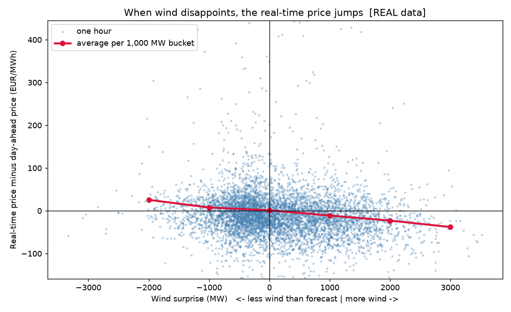
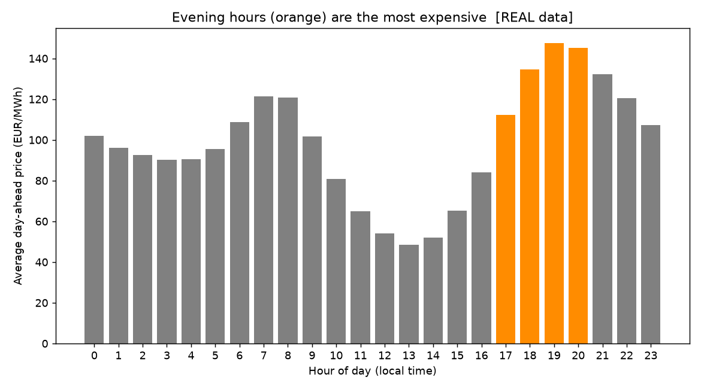
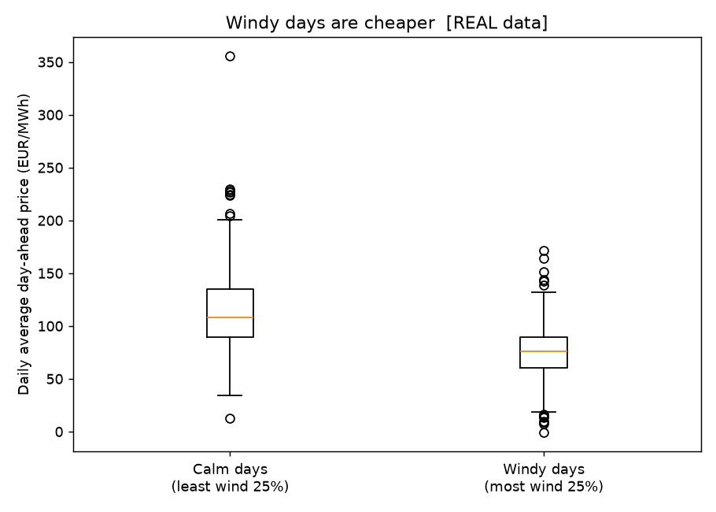
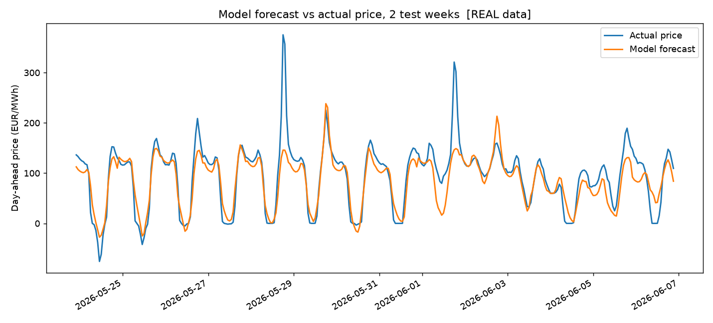
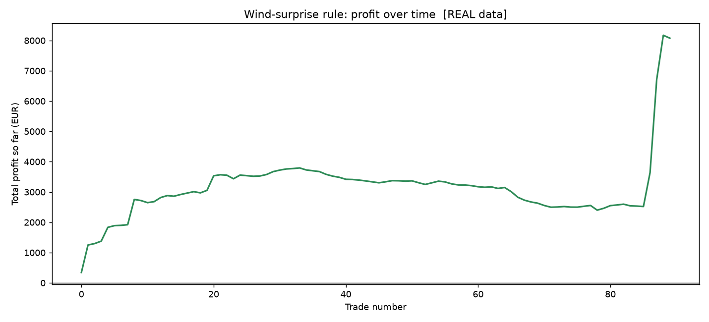
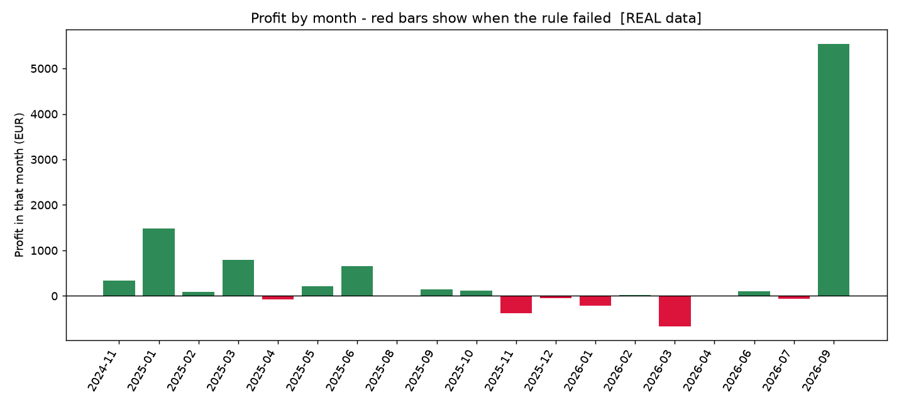

# Wind Surprise → Price Jump
### Do German wind forecast errors create a tradable price move?

> **Note:** fill in the "Results" section with the numbers from **real** data
> (the files in `charts/`). Delete this note before you publish.

---

## 1. Question
Every day, the German power market agrees a **day-ahead price** using a
**wind forecast**. When the real wind turns out **lower than forecast**, the grid
is short of power and the **real-time (imbalance) price** jumps above the
day-ahead price.

**Can a simple rule capture that jump, using only information a trader would
really have at the time?**

## 2. Data
- Source: [ENTSO-E Transparency Platform](https://transparency.entsoe.eu/), via `entsoe-py`
- Market: Germany–Luxembourg (DE-LU), hourly, Oct 2024 – Sep 2026
- Series: day-ahead price, imbalance price, wind forecast (day-ahead),
  actual wind generation (onshore + offshore), solar forecast
- Cleaning: 15-minute data averaged to hourly, all times in UTC with German
  local time added, missing hours counted and removed (see `step2_clean_data.py`)

## 3. Findings
| | |
|---|---|
|  | **Wind surprise vs spread.** _[paste sentence from charts/captions.md]_ |
|  | **Price by hour.** _[paste sentence]_ |
|  | **Windy vs calm days.** _[paste sentence]_ |
|  | **Forecast model.** A linear regression using wind, solar, hour and yesterday's price was _[X]%_ more accurate than the "same as yesterday" guess (see `charts/model_results.txt`). |

## 4. Trade idea and backtest
**Rule:** in the evening (17:00–21:00 German time), if the wind surprise
**2 hours earlier** was below **−1,500 MW**, buy 1 MW for that hour.
Profit per trade = imbalance price − day-ahead price − €1 cost.

*Why 2 hours earlier?* You only learn the actual wind after it happens.
Using the same hour's surprise would be look-ahead bias. Forecast errors are
"sticky", so a recent miss predicts the next few hours.

| Metric | Value |
|---|---|
| Trades | _[ ]_ |
| Total profit (EUR, 1 MW) | _[ ]_ |
| Win rate | _[ ]_ |
| Profit factor | _[ ]_ |
| Worst losing streak | _[ ]_ |
| Max drawdown | _[ ]_ |
| Avg profit, signal vs every evening hour | _[ ] vs [ ]_ |

**Robustness:** _[say whether results hold for thresholds from −500 to −3,000 MW]_

## 5. Risks — why this might not work live
- **Simplified execution:** real traders act in the intraday market, not by
  holding to imbalance settlement. Imbalance exposure is risky and regulated.
- **Spikes:** a few extreme hours can dominate profit. Check results without the top 1% of hours.
- **Data delay:** actual wind data may arrive later than 2 hours in real time.
- **Market changes:** more batteries and better forecasts may shrink this effect over time.
- **One market, two years:** it needs testing on other countries and years.

## 6. What I'd do next
- Use **intraday forecast updates** instead of realised wind, which would be a cleaner signal
- Test **France and Great Britain**
- Add **solar surprise** and **demand surprise**
- Size positions by signal strength instead of a flat 1 MW

---

## How to run it (Windows)
1. Install **Python 3.11+** from python.org (tick *"Add Python to PATH"*).
2. Open this folder, click the address bar, type `cmd`, and press Enter.
3. Install the libraries:
   `pip install -r requirements.txt`
4. *(Optional for practice)* Put your ENTSO-E key in `api_key.txt`.
   Without a key, the project uses **practice data** so you can test everything.
5. Run all steps:
   `python run_all.py`
6. Open the `charts/` folder to see the results.

| File | What it does |
|---|---|
| `settings.py` | All settings: dates, market, threshold |
| `step1_get_data.py` | Downloads real data (or makes practice data) |
| `step2_clean_data.py` | Cleans data, adds wind surprise and spread |
| `step3_charts.py` | Makes charts 1–3 and their captions |
| `step4_forecast_model.py` | Builds and tests the price forecast model |
| `step5_backtest.py` | Tests the trading rule |
| `run_all.py` | Runs everything in order |
